# RelayDock

A **local web companion** for the [OpenCode](https://opencode.ai) CLI. Start it from a terminal, use the interface in your browser, and keep the backend bound to `127.0.0.1`. There is no Rust backend, desktop window, tray app, OS installer, or hosted service.

## Requirements

- Node.js **22.13+** and npm. RelayDock uses the built-in `node:sqlite` module to read OpenCode's local usage database.
- OpenCode CLI v2 for browser-based Console connection management. The v2 flow is verified against `opencode v2.0.26`; the retained v1 contract is tested against `opencode-ai@1.18.35`.

No Rust toolchain or Cargo installation is needed.

## Install from this checkout

```bash
npm install
npm run build
npm link
```

Then, from OpenCode's integrated terminal—or any terminal with npm's global bin directory on `PATH`—run:

```bash
relaydock serve
```

This starts the TypeScript/Node.js local service and opens the web UI. Keep the terminal process running; press **Ctrl+C** to stop the app. To print the URL without opening a browser:

```bash
relaydock serve --no-open
```

`relaydock` is a regular shell command, **not** an OpenCode slash-command/plugin. It does not replace the installed OpenCode binary. By default it manages a local `opencode serve` child for the web app. To route ordinary `opencode` commands through RelayDock's selected proxy, optionally install the PATH wrapper described below. To remove the linked RelayDock command, run `npm unlink -g relaydock` from the checkout.

For development, `npm run web` rebuilds the frontend and starts the local service. `npm run dev` starts only Vite and does not provide the local API. `npm test` runs the Node backend/API tests.

## What it does

- **Accounts** — generates an OpenCode Console sign-in link for the browser, lists locally saved v2 connections, activates or removes a connection, and lets OpenCode store credentials in its local database. No token file import is required.
- **Usage** — reads local request, token, cache, cost, and model counters from OpenCode's SQLite database. Quota is dynamic and has no supported remaining-count API, so the app reports observed usage and quota-hit events rather than inventing requests remaining.
- **Quota watcher** — observes the local server's authenticated event stream and can activate another saved Console connection when a quota event is detected, if auto-rotation is enabled.
- **Proxies** — imports and health-checks an HTTP/HTTPS/SOCKS5 pool. The selected proxy is passed to OpenCode child processes through proxy environment variables. `localhost,127.0.0.1` is always added to any `NO_PROXY` you already have, so local traffic bypasses the proxy. Manual and Auto never fall back to a direct connection: if no proxy can be used, OpenCode does not start and the error says why. Choose **Off** to connect directly; Off also ignores proxy variables inherited from your shell. Proxy changes restart the managed server; an installed CLI wrapper selects the current proxy for each ordinary `opencode` invocation and refuses to run OpenCode when no proxy can be used.
- **Settings** — configures local server startup, account rotation, the OpenCode binary path, and the UI theme.

## Route ordinary OpenCode commands through RelayDock

To make a plain `opencode ...` command use RelayDock's current proxy selection, run:

```bash
relaydock proxy install-wrapper
```

The installer adds a symlink at `~/.local/bin/opencode`; it leaves the real OpenCode installation untouched, checks that `~/.local/bin` precedes the CLI in `PATH`, and delegates each command to the real binary with RelayDock's selected proxy environment. The wrapper is opt-in and only affects commands resolved through that PATH entry; an absolute path to the original binary bypasses it. Open a new terminal or run `rehash` after installation. Remove it with `relaydock proxy uninstall-wrapper`.

## Proxy routing architecture



[Standalone interactive Archify viewer](.archify/architecture-opencode-proxy-20261012-163120/opencode-proxy.html) — download the HTML and open it in a browser; GitHub does not execute repository HTML inside the README.

## Local-only architecture

The React interface and TypeScript/Node.js service are packaged in this repository. The service binds to a random port on `127.0.0.1`, checks Host/Origin headers, issues a per-run session token for mutating API calls and quota events, and serves the built `dist/` assets. Node's built-in SQLite API reads local usage data; Node child processes manage the local OpenCode CLI. The UI/API layer has no hosted service.

Settings and proxy files continue using the former Tauri application identifier as their local config-directory namespace so an existing RelayDock checkout keeps its saved configuration. Set `RELAYDOCK_CONFIG_DIR` to override that directory.

### OpenCode API compatibility

The managed server detects the installed CLI major version. OpenCode v1 uses `/global/health`; OpenCode v2 uses Basic-authenticated `/api/info`, with a per-run password held only by the local Node host. The Accounts page requires v2 and uses the local `/api/integration/opencode` OAuth device flow plus credential activate/remove APIs. It renders the generated browser link; OpenCode completes OAuth and persists the credential to its own local database, so RelayDock never imports or returns credential values. The separate legacy v1 API contract remains pinned to `opencode-ai@1.18.35` in CI.

## Development and verification

```bash
npm install
npm run build
npm test
npm run ui:smoke          # headless Chrome/Chromium; mocked local HTTP API
bash scripts/contract-test.sh
```

The UI smoke suite exercises onboarding, accessible error/retry states, keyboard focus, contrast, and all four pages across light/dark themes and six viewport sizes. It does not use real account credentials or proxy endpoints. Screenshots and detailed measurements are documented in [`docs/ui-smoke-report.md`](docs/ui-smoke-report.md).

## Repository layout

```text
src/                         React web interface and local HTTP API client
server/                      TypeScript local process, account, usage, proxy, watcher, and web-host services
bin/relaydock.cjs             CLI entry point (`serve` and proxy-wrapper management)
scripts/                     UI smoke and OpenCode API contract checks
PRODUCT.md                   Product scope and operating context
PLAN.md                      Web-first implementation plan
```

## License

MIT — see [LICENSE](LICENSE).
