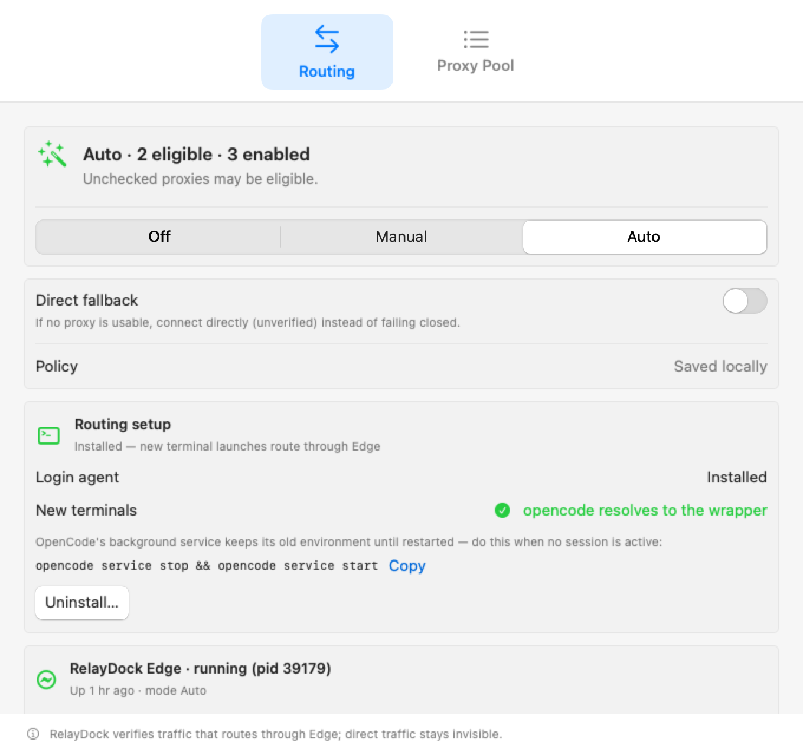
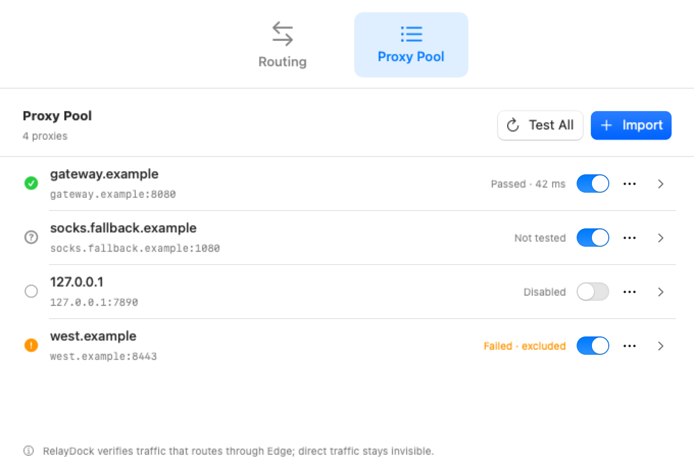
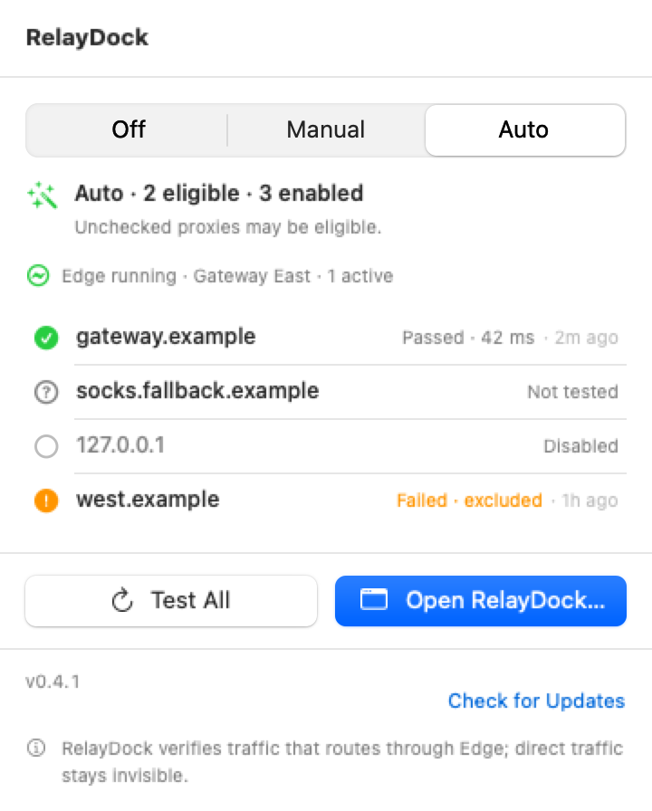
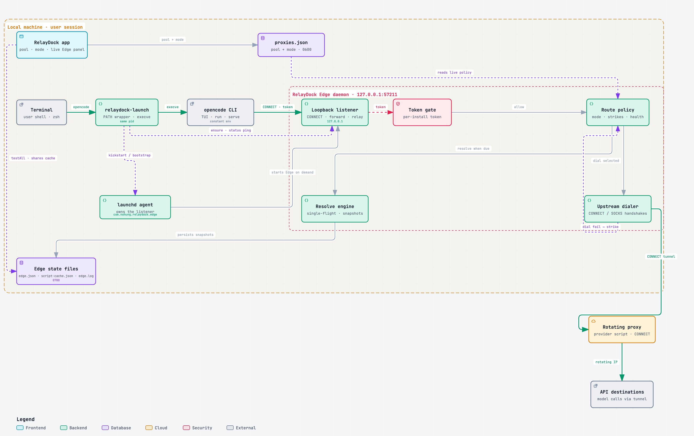
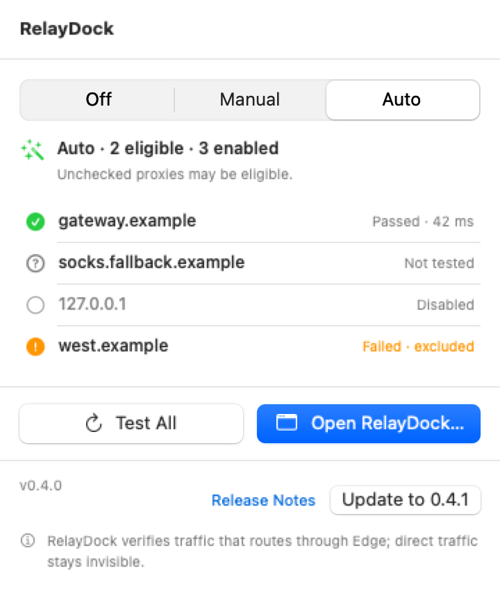
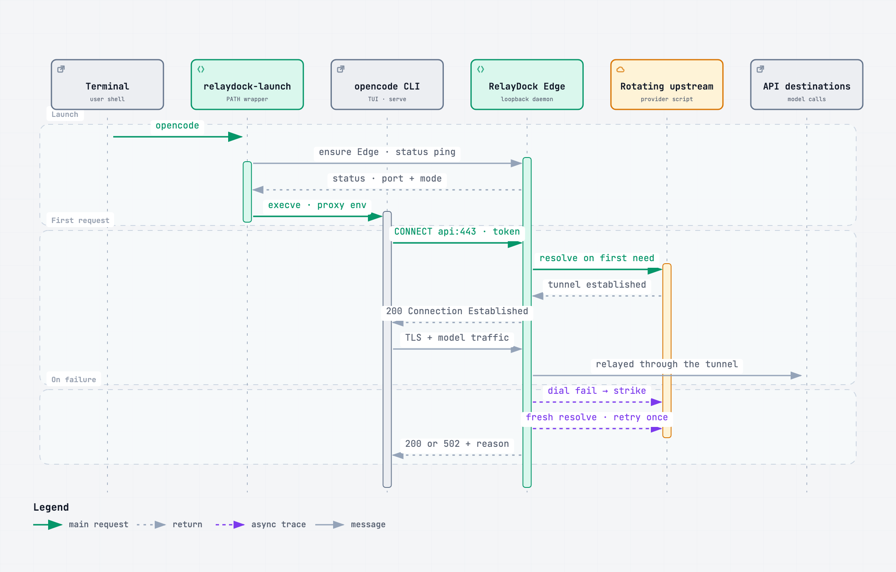

# RelayDock for macOS

<picture>
  <source media="(prefers-color-scheme: dark)" srcset="docs/images/routing-dark.png">
  
</picture>

RelayDock is a compact native SwiftUI utility for managing a local proxy pool and its Off/Manual/Auto policy. It can import proxies, test enabled endpoints, and — with the optional PATH wrapper (see [PATH wrapper for OpenCode](#path-wrapper-for-opencode)) — show what **RelayDock Edge**, a small loopback daemon, is actually doing: the live upstream, rotation counters, and per-process tunnel attribution for everything routed through it. The app does **not** launch or restart OpenCode, and Edge verifies only the traffic that routes through it; direct traffic stays invisible.

**Platform:** macOS 14 or later. **Language:** Swift 6.

## Installation

RelayDock is distributed as an unsigned, unnotarized build, so macOS holds the first launch until you approve it once.

**The app** — import and test proxies, set the Off/Manual/Auto policy, and watch what Edge is doing:

1. Download `RelayDock.dmg` from the [latest release](https://github.com/nxhung1610/relaydock/releases/latest).
2. Open the disk image and drag **RelayDock** into **Applications**.
3. Approve the first launch (Gatekeeper cannot verify the unsigned build):
   - macOS 14: right-click the app → **Open** → **Open** again.
   - macOS 15 or later: try to open it once, then approve it under **System Settings → Privacy & Security → Open Anyway**.
   - Or clear the download quarantine directly: `xattr -dr com.apple.quarantine /Applications/RelayDock.app`

From then on, updates are in-app: a quiet daily check plus **Check for Updates** in every footer.

**The PATH wrapper** — send new terminal `opencode` launches through RelayDock Edge — installs straight from the app:

1. Open RelayDock, go to the **Routing** tab, and click **Install Routing** in the *Routing setup* card. The app installs the same components as the script below: both binaries into `~/.local/bin`, an `opencode` symlink to the launcher (an existing `opencode` that is not the symlink is never replaced), `edge.json` written on first install, and the launchd agent. Running it again updates the binaries in place.
2. Make sure `~/.local/bin` is on `PATH` in new terminals. The card offers a copyable snippet (`export PATH="$HOME/.local/bin:$PATH"`) and a **Verify** button that runs your login shell — `zsh -lic 'command -v opencode'` — and reports what `opencode` resolves to. The app never edits `~/.zshrc` or `~/.zprofile`.
3. Restart OpenCode's background service once, when no session is active: `opencode service stop && opencode service start` (the card copies this too). Terminals that are already open keep their old environment either way.

**Uninstall** lives in the same card: it removes the launchd agent, both `~/.local/bin` files, the `opencode` symlink, and `edge.json` — your proxy pool and Edge's script cache are kept, and the app lists exactly what it removes before you confirm.

Installing from a source checkout, or on a headless machine, still works through the script (builds with Swift 6 + Xcode command line tools):

```sh
git clone https://github.com/nxhung1610/relaydock.git
cd relaydock
scripts/opencode-wrapper.sh install
```

The app deliberately does not launch or restart OpenCode, and it cannot set proxy variables for terminals you open later — those are read once at process start. That enforcement belongs to the wrapper: it sits in `PATH`, ensures Edge is running, and `exec`s the real binary under one constant loopback environment. The app's job is the saved policy and Edge's accounting. The release page also carries the standalone `relaydock-launch` and `relaydock-edge` binaries with a `SHA256SUMS` file for verification.

## Screenshots

**Proxy Pool.** Import one endpoint or a whole list, test the enabled ones, and keep each entry's health, enabled state, and actions together; custom JavaScript entries live in the same list.

<picture>
  <source media="(prefers-color-scheme: dark)" srcset="docs/images/pool-list-dark.png">
  
</picture>

**Menu bar.** The panel is the everyday surface: the saved mode, pool health at a glance, Edge's live line, quick actions, and the update footer.

<picture>
  <source media="(prefers-color-scheme: dark)" srcset="docs/images/panel-dark.png">
  
</picture>

## What it provides

- Import and persist HTTP, HTTPS, SOCKS4, SOCKS4A, SOCKS5, and SOCKS5H proxy URLs — one at a time or in bulk.
- Support named custom JavaScript entries that resolve to a proxy each time a consumer launches a child process.
- Enable, disable, remove, and health-check proxies in the local pool.
- Save Off, Manual, or Auto policy. Manual and Auto configuration remains fail-closed; invalid or missing routes are not silently changed to Off.
- Opt in to **Direct fallback** (Manual/Auto only): when no proxy in the pool is usable, Edge connects directly instead of failing closed — the tunnel is labeled `direct (fallback)` in status and counted, so the degraded route is never silent. Off by default; direct traffic is not verified.
- Preserve existing proxy data at `~/Library/Application Support/com.nxhung.opencodezerolimit/proxies.json` with restrictive file permissions.
- Provide `RelayDockCore` helpers for consumers that launch their own child process and need to select a route and construct proxy environment variables.
- Optionally install a PATH wrapper — **Install Routing** in the app's *Routing setup* card, or `scripts/opencode-wrapper.sh install` from a source checkout — so new terminal `opencode` launches run through **RelayDock Edge**: a loopback daemon that performs script resolution live, rotates the upstream when a dial fails, keeps one provider cooldown budget, and persists one script cache. The installer also bootstraps a launchd KeepAlive agent (crash restarts within seconds; clean exits never respawn-loop; with an `edge.json` present the agent also declares launchd `Sockets`, so Edge starts on the first connection). Fail-closed on routing errors unless the pool's Direct fallback is enabled; Off mode never contacts Edge.
- Show Edge's live status in the app: a RelayDock Edge section on the Routing tab and a compact line in the menu bar popover — mode, upstream with expiry, rotation/failure counters, provider cooldown, and recent tunnels attributed to the peer process that opened them. `Test All` delegates health checks to Edge (the owner of the script cache) and falls back in-process, labeled in the pool view, only when Edge is unreachable.

A successful endpoint check only reports that the configured proxy endpoint passed that check. Neither a saved policy nor a successful check proves that OpenCode traffic used a proxy — only Edge's tunnel accounting speaks to real traffic, and it says nothing about traffic that bypasses Edge: **RelayDock verifies traffic that routes through Edge; direct traffic stays invisible.**

## How it works

RelayDock splits the job in two: the app edits and explains the saved policy (`proxies.json`, permissions 0600), while **RelayDock Edge** — a token-gated loopback daemon — makes every routing decision.

<picture>
  <source media="(prefers-color-scheme: dark)" srcset="docs/images/architecture-dark.png">
  
</picture>

*The seam: every consumer points at one loopback environment; Edge decides, dials, and accounts.*

Everything that opts in talks to that one stable endpoint, so rotation and failover never require restarting a consumer: Edge resolves the selected entry on first need (static URL or JavaScript script), single-flights concurrent resolutions, drops the cached result and re-resolves once when an upstream dies, and keeps one provider cooldown budget and one script cache across every launch.

Manual and Auto stay fail-closed by default: when no upstream is usable, the first CONNECT gets HTTP 502 with a reason. The opt-in **Direct fallback** turns that into a labeled, counted direct connection instead, and Edge's accounting never presents it as proxied; pinned listeners and unreadable state always fail closed. The full policy matrix is in [docs/PROXY-SYSTEM-DESIGN.md](docs/PROXY-SYSTEM-DESIGN.md).

## Updates

The app checks GitHub Releases quietly once a day, and every footer carries a manual **Check for Updates**; a newer release offers its notes and one-click **Update**.

<picture>
  <source media="(prefers-color-scheme: dark)" srcset="docs/images/panel-update-available-dark.png">
  
</picture>

Nothing is staged from a redirect or an unsigned source: the download must come from `github.com`, the archive's SHA-256 must match `SHA256SUMS` from the same release, and the staged bundle's identity, version, and code signature are verified before anything is swapped. Automatic checks stay silent; failures report their real reason. After **Restart to Update**, a helper waits for the app to quit, swaps the bundle with atomic renames (rolling back on failure), relaunches, and lets the next launch surface the outcome once. Design and trust model: [docs/APP-UPDATE-DESIGN.md](docs/APP-UPDATE-DESIGN.md).

## Build, test, and run

Requires macOS 14+ and Swift 6:

```sh
swift test --package-path macOS/RelayDock
scripts/build-macos-app.sh
scripts/build-dmg.sh              # RelayDock.app → build/RelayDock.dmg (drag-to-Applications image)
open build/RelayDock.app
scripts/build-launcher.sh         # PATH wrapper + Edge daemon binaries → build/relaydock-launch, build/relaydock-edge
scripts/launcher-sandbox-test.sh  # hermetic end-to-end: stub command, fake provider/proxies, real launcher + Edge
scripts/tps-bench.sh              # A/B TPS: wrapped (via Edge) vs direct, read back from OpenCode's database
```

The app is currently unsigned and not notarized for public distribution.

## Continuous delivery

`ci.yml` tests every pull request and push to `main` (test suite + app bundle validation).
`cd.yml` packages the same commits into downloadable build artifacts: `RelayDock.dmg` (plus the
bundled `RelayDock.app.zip`), the `relaydock-edge` and `relaydock-launch` binaries, and a
`SHA256SUMS` file — as a workflow artifact (30 days) on every run. Pushing a `v*` tag additionally
publishes the same files as a GitHub Release. Packaged builds are unsigned, exactly like local
`scripts/build-*.sh` ones.

## Core library

Add the `macOS/RelayDock` Swift package and import `RelayDockCore` from a process-launching consumer:

```swift
import RelayDockCore

let proxies = ProxyStore()
// Optional: carry script caches across launches of a fresh consumer process.
importProxyScriptCacheSnapshots(try readSnapshotsFromDisk())
let selectedProxyURL = try proxies.selectForSpawn()
let childEnvironment = buildOpenCodeProxyEnvironment(proxyURL: selectedProxyURL)
try writeSnapshotsToDisk(exportProxyScriptCacheSnapshots())
```

`exportProxyScriptCacheSnapshots()` / `importProxyScriptCacheSnapshots(_:)` carry each entry's in-memory script `cache` across process launches: import before `selectForSpawn()`, export after it, and store the map wherever your consumer keeps state. Import skips entries that are not JSON objects or exceed the 64 KB cache limit.

`selectForSpawn()` returns `nil` only for explicit Off mode. Do not catch a Manual/Auto selection error and continue with `nil`; surface the error and do not launch the child process. Auto may use enabled proxies whose health is unknown, but excludes proxies whose last recorded check failed. When the selection is a custom JavaScript entry, `selectForSpawn()` runs the script first; a script error, timeout, or invalid result is thrown so the launch stays fail-closed. The consumer must actually use the returned environment when launching the child and must independently verify its HTTP client's behavior. (The PATH wrapper below no longer calls `selectForSpawn()` itself — it delegates to RelayDock Edge; the core API remains the supported path for custom consumers.)

Set `RELAYDOCK_CONFIG_DIR` or pass `configDirectory:` to `ProxyStore` to use another configuration directory. The library reuses existing proxy pools and does not migrate or delete user data.

## Custom JavaScript proxies

**Add One → Type → Custom (JS)** stores a named script instead of a fixed URL. In the wrapped flow the script runs inside RelayDock Edge each time a route is resolved, so it can fetch a fresh proxy from a provider API and rotate when the endpoint dies:

```js
if (!cache.url) {
  const res = await fetch("https://api.example.com/proxy", { headers: { "Authorization": "Bearer …" } });
  cache.url = (await res.json()).url; // or a "host:port" string
}
return cache.url;
```

- Scripts run in a sandboxed JavaScriptCore context with no file, process, or module access (`require`/`import` are unavailable). The surface is Node-flavoured but synchronous underneath: `fetch`/`await` (GET/HEAD/POST), `setTimeout`/`setInterval`, `URL`/`URLSearchParams`, `Buffer`, `TextEncoder`/`TextDecoder`, `crypto` (`createHash`/`createHmac` for SHA-256/384/512, `randomUUID`, `randomBytes`), `structuredClone`, `performance.now`, the synchronous `http.get(url, headers?)`/`http.post(url, body, headers?)` helpers (responses capped at 256 KB, request bodies at 64 KB), `btoa`, `atob`, and a no-op `console`. The script must `return` a proxy URL or `host:port`; the value is validated with the same parser as imported URLs.
- A global `cache` object persists between runs of the same entry (capped at 64 KB of JSON). Edge persists it to `<config>/script-cache.json`, so resolutions survive rotations and Edge restarts; the cache is keyed to a hash of the script, and editing the script drops its stale data immediately. It is also dropped whenever a run fails or times out; do not redeclare it in the script.
- Resolution is fail-closed: a script error, a 10-second timeout, or an invalid result throws `ProxyStoreError.scriptFailed`. With the wrapper this surfaces at request time — the launch itself never blocks on provider timing, and Edge answers the first request with HTTP 502 if no upstream is usable, unless the pool's Direct fallback is enabled (then it dials direct, labeled and counted). Health checks probe the URL the entry is currently serving — never the script — so a script entry with nothing resolved yet is deferred and keeps its last health; `Test All` can never rotate the exit or spend the provider's change cooldown.
- Scripts can contain credentials and are stored as written in `<config>/proxies.json` (file permissions 0600). The app masks credentials in resolved previews.
- Rename or re-script an entry from the pool row's ⋯ menu (**Edit Script…**). Editing keeps the entry's identity, so Manual and sticky selections survive; changing the script clears its last recorded check and its in-memory `cache` (renaming keeps both).

## PATH wrapper for OpenCode

`scripts/opencode-wrapper.sh` installs an opt-in wrapper that applies the saved policy to new terminal `opencode` launches — or install it straight from the app: **Routing** tab → *Routing setup* → **Install Routing**. Both routes install the same components; the app's copy ships inside the bundle, and its **Verify** button checks what a login shell actually resolves `opencode` to. The wrapper is deliberately thin: it reads `<config>/edge.json`, ensures **RelayDock Edge** is running, prints the routing line from Edge's status, and replaces itself with `opencode` under a **constant** proxy environment. Edge owns live resolution, rotation, health checks, and the script cache.

<picture>
  <source media="(prefers-color-scheme: dark)" srcset="docs/images/launch-sequence-dark.png">
  
</picture>

*One wrapped launch: ensure Edge, print the routing line, `execve` under one constant environment — resolution, tunneling, and failure accounting then belong to Edge.*

```sh
scripts/opencode-wrapper.sh install    # builds if needed; installs relaydock-launch + relaydock-edge; writes <config>/edge.json on first install; bootstraps the launchd KeepAlive agent
scripts/opencode-wrapper.sh status     # wrapper paths, agent state, + live Edge status (equivalent: relaydock-edge status)
scripts/opencode-wrapper.sh uninstall  # boots out the agent; stops Edge; removes the symlink, both binaries, and edge.json
```

Each launch:

- Reads `edge.json` (loopback port + per-install token). The port never renumbers silently once consumers hold the environment: if Edge cannot bind at runtime it exits loudly (`edge.log`) and the launcher refuses with a reinstall hint.
- Ensures Edge is running: with a socket-activated plist the launcher waits briefly for launchd to start Edge on the first connection (its status pings are the connection); otherwise a loaded KeepAlive agent is kickstarted (bootstrapped first if not loaded), else `relaydock-edge` is spawned detached. Concurrent starts are safe; the loser exits quietly, and `KeepAlive { SuccessfulExit: false }` means a clean loser-exit never respawn-loops.
- Prints one line to stderr from Edge's live status — `RelayDock: routed via Edge on 127.0.0.1:<port> — <entry> (<masked URL>)`, or a "first request resolves the upstream" note when Edge has not resolved yet; set `RELAYDOCK_QUIET=1` to silence it.
- Sets `HTTP_PROXY`/`HTTPS_PROXY`/`ALL_PROXY` (and lowercase variants) to the constant `http://<token>:@127.0.0.1:<port>`, merges `NO_PROXY=localhost,127.0.0.1` so the local OpenCode server keeps working, and removes `OPENCODE_SERVER_*` variables from the child environment. (The colon after the token is load-bearing: OpenCode's HTTP stack only sends `Proxy-Authorization` for a `username:password` userinfo; verified against the real binary.)
- Fails closed — exit 1, command not started, reinstall hint — when `edge.json` is missing or damaged or when Edge cannot be reached or started after spawning. Never a silent direct launch. Off mode launches the command with no proxy variables and never contacts Edge.

Edge itself:

- Resolves the selected entry (static URL or JavaScript script) on demand and single-flight; when a dial to the upstream fails it drops the cached script result, re-resolves, and retries once — **rotation no longer requires restarting anything**.
- Keeps one provider cooldown budget and one cache across all launches in `<config>/script-cache.json` (one-time adoption of the old `launcher-cache.json`); per-script hashes drop stale results the moment a script is edited.
- Pins extra loopback listeners when `edge.json` declares `listeners: [{port, entryID}]`: each such port serves exactly that pool entry — an explicit binding that ignores global Off mode and never falls back to direct — and `/status` lists every listener with its `activated` flag.
- Health-checks endpoints on a 10-minute cadence (with backoff after failures) and never blocks a launch on provider timing: if no upstream is usable, the **first request** gets HTTP 502 from Edge instead of a failed launch — or dials direct when the pool's Direct fallback is on, labeled `direct (fallback)` and counted.
- Binds `127.0.0.1` only and requires the token on every proxy and admin request. `GET /__relaydock/status` reports mode, upstream, counters, and best-effort same-user tunnel attribution — it is a status surface, not a second control plane.

OpenCode's background service — not the CLI you start — performs model calls using the environment it was started with. Restart it once from a wrapped shell after installing the wrapper:

```sh
opencode service stop && opencode service start   # interrupts active sessions
```

With the constant environment, later endpoint rotations need no service restart. A cold start (no service running) inherits the wrapper's environment automatically. `opencode service restart` respawns the service without your shell environment — use stop + start.

The wrapper only affects commands started after it is installed; already-running processes and the app are untouched. It replaces itself with the command, so the launched process keeps the shell job's pid and foreground process group — terminal job control, Ctrl+C, and full-screen TUIs behave as if the wrapper were not there. Verify a launch independently (the routing line reports the environment the wrapper set, and Edge's status reports the tunnels it served — neither proves that every OpenCode process used a proxy):

```sh
ps eww -p <opencode pid> | tr ' ' '\n' | grep -i proxy
lsof -nP -iTCP -a -p <opencode pid> | grep ESTABLISHED
relaydock-edge status
```

`scripts/launcher-sandbox-test.sh` exercises the wrapper, Edge, and the installer end-to-end against a stub command, a fake `launchctl`, and local fake provider/proxies — cold start, warm sticky launch, live rotation, script-edit invalidation, the token gate, fail-closed paths, the spawn race, crash respawn, Off-mode checks, agent kickstart/bootout, socket activation (an inherited listener), pinned listeners, and job control — with no real OpenCode CLI, accounts, or network.

## Scope

Account login, usage reporting, quota recovery, app settings, and OpenCode process management are not part of this proxy-only app. Former behavior is recorded in [docs/REMOVED-FEATURES.md](docs/REMOVED-FEATURES.md) for historical reference. The interface follows the [proxy app wireframe](docs/PROXY-APP-WIREFRAME.md).

## License

MIT — see [LICENSE](LICENSE).
