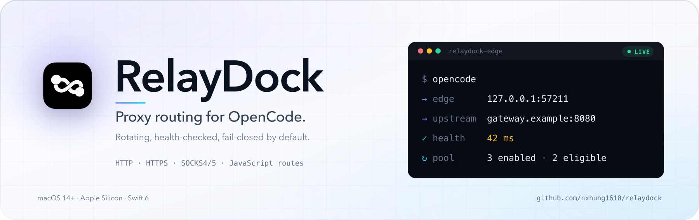
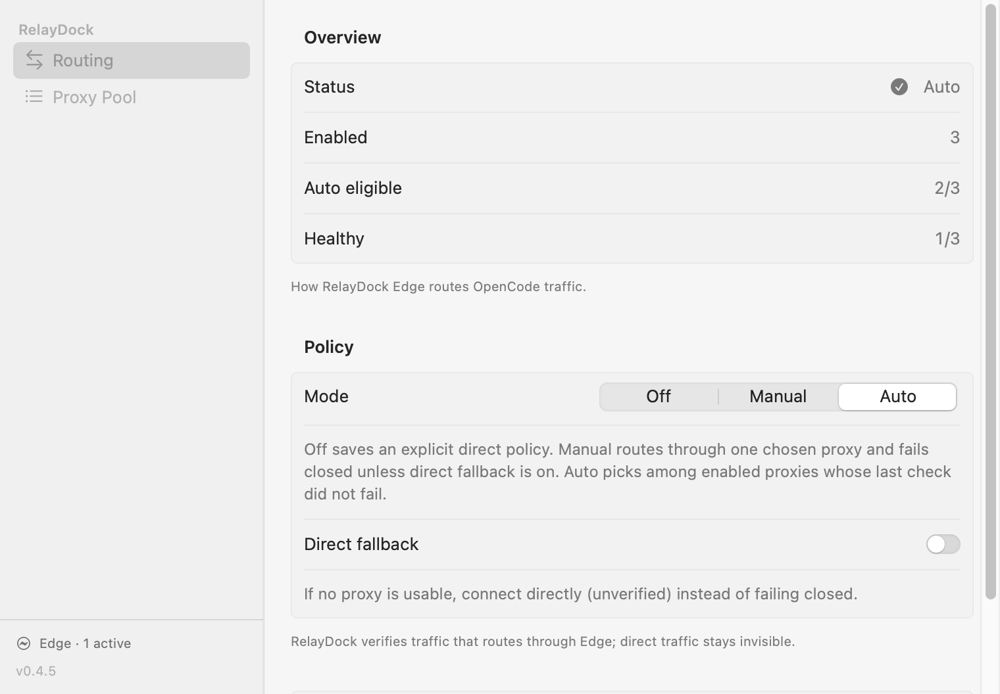
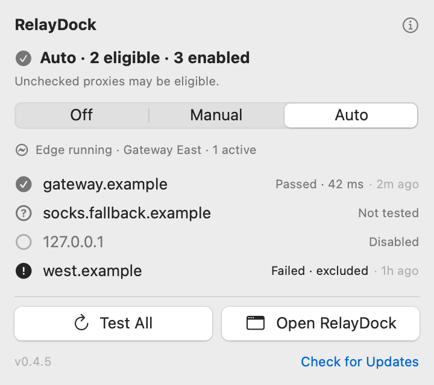

<p align="center">
  <picture>
    <source media="(prefers-color-scheme: dark)" srcset="brand/readme-hero-dark.png">
    
  </picture>
</p>

<p align="center">
  <a href="https://github.com/nxhung1610/relaydock/releases/latest"></a>
  <a href="https://github.com/nxhung1610/relaydock/actions/workflows/ci.yml"></a>
  <a href="LICENSE"></a>
  
  
  
</p>

<p align="center">
  <a href="#install"><strong>Install</strong></a> ·
  <a href="#features">Features</a> ·
  <a href="#see-it-in-action">Screenshots</a> ·
  <a href="#how-it-works">How it works</a> ·
  <a href="#updates">Updates</a> ·
  <a href="#security--privacy">Security</a> ·
  <a href="#faq">FAQ</a> ·
  <a href="#documentation">Docs</a>
</p>

RelayDock is a native macOS menu-bar app plus a loopback daemon for a local proxy pool. Its optional PATH wrapper sends new OpenCode launches through **RelayDock Edge**, which resolves, rotates, and accounts for every tunnel. The app never launches or restarts OpenCode; traffic that bypasses Edge stays invisible.

## Features

<table>
  <tr>
    <td width="50%" valign="top">
      <strong>🔁 Rotating pool</strong><br>
      <sub>HTTP, HTTPS, SOCKS4/4A/5/5H proxies, imported individually or in bulk.</sub>
    </td>
    <td width="50%" valign="top">
      <strong>🧩 Custom JavaScript entries</strong><br>
      <sub>Named scripts with per-script caching and automatic re-resolution on dial failure.</sub>
    </td>
  </tr>
  <tr>
    <td width="50%" valign="top">
      <strong>🧭 Off, Manual, Auto</strong><br>
      <sub>Manual and Auto fail closed and never silently become Off.</sub>
    </td>
    <td width="50%" valign="top">
      <strong>🛟 Direct fallback</strong><br>
      <sub>Opt-in, labeled, counted. Off by default; direct traffic is not verified.</sub>
    </td>
  </tr>
  <tr>
    <td width="50%" valign="top">
      <strong>🗂️ Local-first</strong><br>
      <sub>Pool at <code>~/Library/Application Support/com.nxhung.opencodezerolimit/proxies.json</code> with <code>0600</code> permissions, plus <code>RelayDockCore</code> helpers for custom launchers.</sub>
    </td>
    <td width="50%" valign="top">
      <strong>📊 Live Edge status</strong><br>
      <sub>Upstream and expiry, rotation/failure counters, provider cooldown, recent tunnels with peer-process attribution, and the aggregate menu-bar count.</sub>
    </td>
  </tr>
</table>

A successful check only means the proxy passed a request to `https://www.gstatic.com/generate_204`; it does not verify OpenCode authentication, model access, or quota.

## See it in action

<p align="center">
  <picture>
    <source media="(prefers-color-scheme: dark)" srcset="docs/images/readme-routing-dark.png">
    
  </picture>
</p>

<p align="center"><sub>Routing, policy, and live Edge status in one window.</sub></p>

<p align="center">
  <picture>
    <source media="(prefers-color-scheme: dark)" srcset="docs/images/readme-panel-dark.png">
    
  </picture>
</p>

<p align="center"><sub>The menu bar panel stays one click away.</sub></p>

## Install

<p align="center">
  <a href="https://github.com/nxhung1610/relaydock/releases/latest"></a>
</p>

### The app

RelayDock is ad-hoc signed and not notarized, so macOS holds the first launch until you approve it:

1. Download `RelayDock.dmg` from the [latest release](https://github.com/nxhung1610/relaydock/releases/latest).
2. Open the image and drag **RelayDock** into **Applications**.
3. Approve the first launch:
   - macOS 14: right-click the app → **Open** → **Open** again.
   - macOS 15+: try to open it once, then use **System Settings → Privacy & Security → Open Anyway**.
   - Or clear quarantine: `xattr -dr com.apple.quarantine /Applications/RelayDock.app`

Updates are in-app: a quiet daily check plus **Check for Updates** in every footer.

### The PATH wrapper (optional)

1. In RelayDock, open **Routing** → expand **RelayDock Edge & routing setup** → **Install Routing**. This installs `relaydock-launch` and `relaydock-edge` into `~/.local/bin`, an `opencode` symlink (an existing non-symlink `opencode` is never replaced), `edge.json`, and a launchd agent. Re-running updates the binaries in place.
2. Add `~/.local/bin` to `PATH` in new terminals. The app offers a copyable snippet and a **Verify** button that runs `zsh -lic 'command -v opencode'`; it never edits `~/.zshrc` or `~/.zprofile`.
3. Restart OpenCode's background service once, when no session is active: `opencode service stop && opencode service start`.

**Uninstall** removes the launchd agent, both binaries, the symlink, and `edge.json`; your proxy pool and Edge's script cache are kept.

From a source checkout:

```sh
git clone https://github.com/nxhung1610/relaydock.git
cd relaydock
scripts/opencode-wrapper.sh install
```

The wrapper only affects new launches: it sits in `PATH`, ensures Edge is running, and `exec`s the real binary under one constant loopback environment. Standalone `relaydock-launch` and `relaydock-edge` binaries are on the release page with `SHA256SUMS`.

## How it works

<p align="center">
  <picture>
    <source media="(prefers-color-scheme: dark)" srcset="docs/images/architecture-dark.png">
    
  </picture>
</p>

RelayDock splits the job in two: the app edits the saved policy (`proxies.json`, `0600`), while **RelayDock Edge** makes every routing decision. Consumers point at one stable loopback endpoint, so rotation and failover never require restarting them. Edge resolves the active entry at startup (static URL or JavaScript script), single-flights concurrent resolutions, drops the cached result and re-resolves once when an upstream dies, and keeps one provider cooldown budget and one script cache.

Manual and Auto stay fail-closed: when no upstream is usable, the first CONNECT gets HTTP 502 with a reason. **Direct fallback** turns that into a labeled, counted direct connection; pinned listeners and unreadable state always fail closed. See the [system design](docs/PROXY-SYSTEM-DESIGN.md) for the policy matrix.

### Edge behavior

- Health-checks the active upstream every 10 minutes; failed entries retry after 5/15/60 minutes, and other entries only via **Test All**.
- Turns an OpenCode `FreeUsageLimitError` into a pause for the proxy that delivered it and, on OpenCode 2.x, a bounded automatic retry through another eligible proxy (at most three requests in total: the original plus two retries). Manual borrows the rest of the pool for the pause; pinned listeners never fail over.
- Serves any local client on `127.0.0.1` without authentication. `GET /__relaydock/status` is read-only; `GET/POST /__relaydock/check` and `POST /__relaydock/shutdown` are unauthenticated too.
- The wrapper sets `HTTP_PROXY`/`HTTPS_PROXY`/`ALL_PROXY` (and lowercase) to `http://127.0.0.1:<port>`, replaces `NO_PROXY` with loopback-only `localhost,127.0.0.1` so an inherited bypass rule cannot send provider traffic around Edge, removes `OPENCODE_SERVER_PASSWORD` and `OPENCODE_SERVER_USERNAME`, and fails closed if Edge is unreachable.

## Updates

The app checks GitHub Releases quietly once a day; every footer has **Check for Updates**. A newer release offers notes and one-click **Update**.

Assets come from the GitHub Releases API over TLS, the archive's SHA-256 must match `SHA256SUMS`, and the staged bundle's identifier, version, and ad-hoc signature are checked. This protects integrity, not publisher identity: builds are ad-hoc signed, not Developer ID-signed or notarized. The helper swaps the bundle with atomic renames and rollback, then relaunches and reports the outcome once. See the [update design](docs/APP-UPDATE-DESIGN.md).

## Requirements

- macOS 14+, Apple Silicon (arm64). Release builds are arm64-only.
- OpenCode is optional. The wrapper is tested with OpenCode 2.0.30 (Bun); other versions are untested.
- Swift 6 and Xcode command line tools for source builds.
- No third-party runtime dependencies. Health checks use system `curl`.

## Security & privacy

- **Loopback only.** No LAN listener, system proxy, VPN, or root helper.
- **No authentication since v0.4.1.** Any local process can use the proxy, read status, run checks, and request shutdown; use it on a Mac you trust.
- **Credentials stay local.** `proxies.json` is `0600`, and the app masks credentials in previews. Custom scripts run in JavaScriptCore without file, process, or module access.
- **No telemetry.** Network calls are health checks, your scripts, the daily release check, and requested update downloads.
- **Ad-hoc signed.** Verify archives against `SHA256SUMS` before opening them.

Report vulnerabilities privately — see [SECURITY.md](SECURITY.md).

## FAQ

**Does RelayDock proxy all traffic?**
No. It is not a system proxy or VPN. Only processes pointed at Edge — the wrapper or your own client — send traffic through it.

**Does it modify `~/.zshrc` or `~/.zprofile`?**
No. It shows a copyable `PATH` snippet; the installer writes only its binaries, the `opencode` symlink, `edge.json`, and a launchd plist.

**Which protocols are supported?**
HTTP, HTTPS, SOCKS4/4A/5/5H, plus custom JavaScript entries.

**What happens when no proxy is usable?**
Manual and Auto fail closed with HTTP 502 on the first request. With **Direct fallback**, Edge connects directly, labels the tunnel, and counts it; pinned listeners never fall back.

## Documentation

| Document | What it covers |
| --- | --- |
| [Proxy system design](docs/PROXY-SYSTEM-DESIGN.md) | Route selection, the policy matrix, Edge lifecycle, and failure handling |
| [App update design](docs/APP-UPDATE-DESIGN.md) | Update feed, checksum and identity verification, atomic swap, and rollback |
| [Proxy app wireframe](docs/PROXY-APP-WIREFRAME.md) | Current shell and the historical wireframe variants |
| [Removed features](docs/REMOVED-FEATURES.md) | Historical scope decisions and former behavior |

## Development

Requires macOS 14+, Apple Silicon, and Swift 6:

```sh
swift test --package-path macOS/RelayDock
scripts/build-macos-app.sh
scripts/build-dmg.sh              # RelayDock.app → build/RelayDock.dmg
open build/RelayDock.app
scripts/build-launcher.sh         # wrapper + Edge binaries → build/relaydock-launch, build/relaydock-edge
scripts/launcher-sandbox-test.sh  # hermetic end-to-end: launcher + Edge, fake provider
scripts/tps-bench.sh              # A/B TPS: wrapped vs direct
```

The app is ad-hoc signed and not notarized. `ci.yml` tests every PR and push to `main`; `cd.yml` packages the app, the standalone binaries, and `SHA256SUMS`, then publishes them on `v*` tags.

## Core library

`RelayDockCore` is a plain Swift package in `macOS/RelayDock`. For consumers that launch their own child process:

```swift
import RelayDockCore

let proxies = ProxyStore()
let url = try proxies.selectForSpawn()
let env = buildOpenCodeProxyEnvironment(proxyURL: url)
```

`selectForSpawn()` returns `nil` only for Off; surface Manual/Auto errors instead of treating them as `nil`. When the selection is a script, errors, timeouts, or invalid output throw, keeping the launch fail-closed. To carry script caches across launches, use `importProxyScriptCacheSnapshots(_:)` before and `exportProxyScriptCacheSnapshots()` after `selectForSpawn()`. The PATH wrapper delegates to Edge and does not call this API.

## Custom JavaScript proxies

**Add One → Type → Custom (JS)** stores a named script. Edge runs it whenever a route is resolved:

```js
if (!cache.url) {
  const res = await fetch("https://api.example.com/proxy", { headers: { Authorization: "Bearer …" } });
  cache.url = (await res.json()).url; // or "host:port"
}
return cache.url;
```

Scripts run in sandboxed JavaScriptCore with no file, process, or module access; `fetch`, timers, `URL`, `Buffer`, `crypto`, `http.get/post`, and `btoa`/`atob` are available. A global `cache` persists per script (64 KB) in `<config>/script-cache.json`; a failed run keeps the last successful snapshot, and Edge drops it when a dial fails. Errors, a 10-second timeout, or invalid output throw, so the route stays fail-closed. Health checks probe the current URL, never the script, so **Test All** cannot rotate the exit. Editing keeps the entry's identity; changing the script clears its health and cache.

## Scope

Account login, usage reporting, quota recovery, app settings, and OpenCode process management are out of scope. See [removed features](docs/REMOVED-FEATURES.md) for former behavior; the current UI is described in the [wireframe](docs/PROXY-APP-WIREFRAME.md).

## Contributing

Issues and pull requests are welcome. Read the [system design](docs/PROXY-SYSTEM-DESIGN.md) before changing routing, Edge lifecycle, or updates; see [CONTRIBUTING.md](CONTRIBUTING.md) for build and test expectations.

## License

MIT — see [LICENSE](LICENSE).
